<a href="https://eliasjhl.dev">
  <picture>
    <source media="(prefers-color-scheme: dark)" srcset="./assets/banniere-sombre.svg">
    
  </picture>
</a>

**Closer to the metal.** I write code that runs at the lowest level: a shell, an FTP server, an OS on a Raspberry Pi Pico. An Epitech student, I am spending this year at Jönköping University in Sweden, taking master’s-level cybersecurity courses.

<picture>
  <source media="(prefers-color-scheme: dark)" srcset="./assets/etiquettes-sombre.svg">
  
</picture>
<a href="https://tryhackme.com/p/EliasJHL"><picture>
  <source media="(prefers-color-scheme: dark)" srcset="./assets/tryhackme-sombre.svg">
  
</picture></a>
<a href="https://profile.hackthebox.com/profile/019c5e09-247a-73be-8a66-29a554399852"><picture>
  <source media="(prefers-color-scheme: dark)" srcset="./assets/hackthebox-sombre.svg">
  
</picture></a>

### Now

- Lead developer of [KansoOS](https://github.com/KansoOS), a hardened Android (AOSP) built for neurodivergent autonomy, in a team of 5.
- Exchange year in cybersecurity at Jönköping University: penetration testing, forensics and incident response, industrial cybersecurity.
- Freelance software engineer, building management software for small businesses.

### Selected work

- [**My_FTP**](https://github.com/EliasJHL/My_FTP): a multi-client FTP server in C++, one `poll()` loop and a `fork()` per transfer.
- [**42sh**](https://github.com/EliasJHL/42sh): a POSIX shell in C, with a syntax tree, pipes, redirections and job control.
- [**RayTracer**](https://github.com/EliasJHL/RayTracer): a ray tracing renderer in C++17.

### Toolbox

<picture>
  <source media="(prefers-color-scheme: dark)" srcset="./assets/outils-sombre.svg">
  
</picture>

<picture>
  <source media="(prefers-color-scheme: dark)" srcset="./assets/releve-sombre.svg">
  
</picture>

More on [eliasjhl.dev](https://eliasjhl.dev), or write to contact@eliasjhl.dev.
